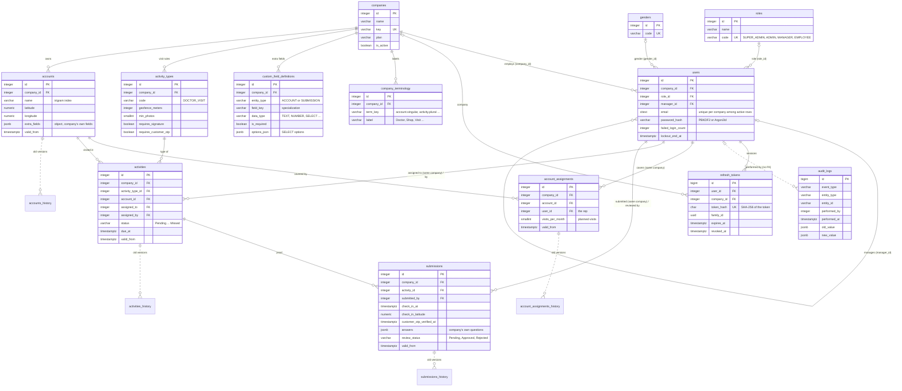

# Workiya database: entity relationship diagram

PostgreSQL 18 with PostGIS (Neon), owned by Workiya alone. The schema is created by the
migrations in `backend/db/postgres/`. The old SQL Server design (the shared `dbTest_VSE`
database) is kept for history in `backend/db/sqlserver-archive/`, and
`docs/database/postgres-migration-plan.md` records the move.

| Group | Tables |
|---|---|
| Reference data | genders, roles |
| Identity and tenancy | companies, users |
| Auth and audit | refresh_tokens, audit_logs (append-only), schema_migrations |
| Company settings | company_terminology, custom_field_definitions, activity_types |
| Field work | accounts, account_assignments, activities, submissions, each with a `<table>_history` table |

Naming: tables are plural snake_case, columns snake_case, and times are `timestamptz` (UTC)
named `*_at`. Every table has `created_at`, `updated_at`, `created_by`, `updated_by` and
`is_deleted` (soft delete); `audit_logs` has only `created_at` and `created_by`.

Only key columns are drawn. `erd.html` in this folder still shows the SQL Server design.

## Rules the design enforces

- **Company isolation in the database itself.** `users` is unique on `(company_id, id)`.
  activities point at accounts, activity_types and the assigned user through
  `(company_id, ...)` foreign keys; submissions point at activities and the submitting user,
  and account_assignments at accounts and the rep, in the same way. A row can never reference
  another company's data, even if the API has a bug. `assigned_by` and `reviewed_by` may be
  any user (for example a super admin).
- **Change history.** accounts, account_assignments, activities and submissions have a
  `valid_from` column. On every UPDATE or DELETE the trigger function `record_history()` copies
  the old row, with `valid_to = now()`, into `<table>_history` (no keys, no foreign keys).
- **Audit log is append-only.** Triggers on `audit_logs` reject UPDATE, DELETE and TRUNCATE;
  the migration also documents the REVOKE for the app role.
- **Who covers which account.** account_assignments links reps to accounts (several reps per
  account are allowed) with a planned visit frequency, so missed visits can be detected.
- **Soft delete.** Rows are never physically deleted by the app. Unique keys such as user email
  and username or custom field keys are partial unique indexes `WHERE NOT is_deleted`.
- **Company-specific data is JSON with a definition.** `accounts.extra_fields` (a JSON object)
  and `submissions.answers` are `jsonb`, and each key is described in
  `custom_field_definitions`.
- **Old pharma tables are not moved.** Doctors, Tasks, TaskFeedback and the `Legacy*Id`
  columns stay in SQL Server; `backend/scripts/copy-sqlserver-to-postgres.js` copies
  everything else once.
