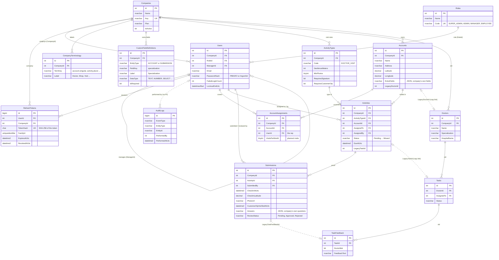

# Workiya database: entity relationship diagram

Database `dbTest_VSE` (SQL Server 2017), shared with another system. This diagram covers the
tables Workiya uses. Other tables in the same database (`Tenants`, `UserRoles`, `UserConfigs`,
`UserType`, `Genders`, `SniffTest`, `SniffJoin`) belong to that system and are not shown.

| Group | Tables | Status |
|---|---|---|
| Identity and tenancy | Companies, Roles, Users | Existing |
| Auth and audit | RefreshTokens, AuditLogs, SchemaMigrations | Existing (migration 20261016120000) |
| Company settings | CompanyTerminology, CustomFieldDefinitions, ActivityTypes | **New** (migration 20261021100000) |
| Field work | Accounts, AccountAssignments, Activities, Submissions | **New**, with temporal history tables (AccountAssignments: migration 20261021110000) |
| Old pharma tables | Doctors, Tasks, TaskFeedback | Backup only; the code stops using them |

Only key columns are drawn. `erd.html` in this folder lists every column.

## Rules the design enforces

- **Company isolation in the database itself.** Activities point at Accounts and ActivityTypes
  through `(CompanyId, Id)`, and Submissions point at Activities the same way. A row can never
  reference another company's data, even if the API has a bug.
- **Change history.** Accounts, Activities and Submissions are SQL Server temporal tables.
  Every update and delete is kept automatically in `AccountsHistory`, `ActivitiesHistory` and
  `SubmissionsHistory`.
- **Who covers which account.** AccountAssignments links reps to accounts (several reps per
  account are allowed) with a planned visit frequency, so missed visits can be detected.
- **Soft delete.** Every new table has `IsDeleted`; rows are never physically deleted by the app.
- **Company-specific data is JSON with a definition.** `Accounts.ExtraFields` and
  `Submissions.Answers` must be valid JSON (CHECK constraint), and each key is described in
  `CustomFieldDefinitions`.
- **Old tables stay untouched.** The copy keeps `Legacy*Id` links so every new row can be
  traced back to the Doctors / Tasks / TaskFeedback row it came from.
